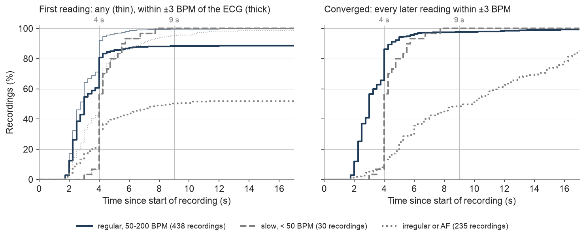
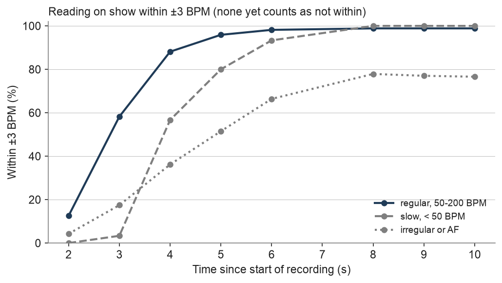
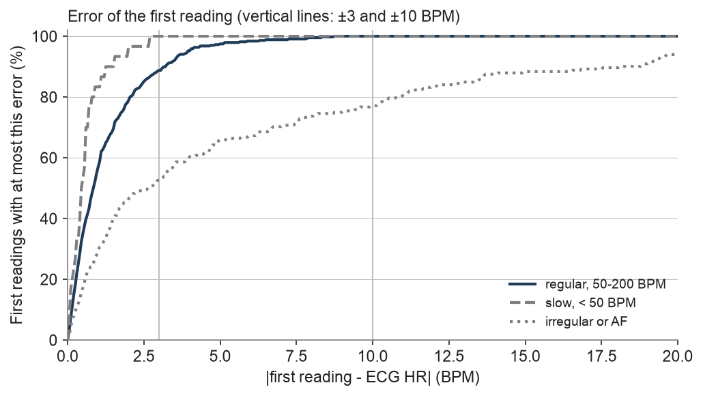

# Results

Evaluation of the current version: test and validation results per group, targets, time to
converge, accuracy over time, first-reading error, strata, stress tests, settings trade-off and
corner cases. Every table and figure below is generated from the runs named here;
aggregates only. The C port's agreement with the Python reference and
the resources: [realtime_implementation.md](realtime_implementation.md).

<!-- begin:results_header -->
| Version | Model | Generated | Commit | Runs |
|---|---|---|---|---|
| 2.0.0 | hr_v10c | 2026-11-13 | bbf88ed | val `20261113_161950_hr_v10c_val_v2.0.0`, test `20261113_162005_hr_v10c_test_v2.0.0`, stress `20261113_162107_hr_v10c_test_v2.0.0_stress` |
<!-- end:results_header -->

## Contents
1. How the results are produced
2. Test results per group
3. Targets
4. Time to converge
5. Accuracy over time
6. First-reading error
7. Strata
8. Validation
9. Stress test
10. Settings trade-off
11. Corner cases

## 1. How the results are produced
- Every recording streams through the device code in 50 ms blocks, as on the device; no
  whole-recording shortcut.
- Each reading is compared with the ECG heart rate over the same seconds ([data.md](data.md)
  §3). Recordings without a trusted ECG and recordings whose beats are not heard are reported
  apart.
- Groups: regular rhythm at 50-200 BPM, slow (below 50 BPM), irregular (ECG beat-interval
  variation at least 5 % or AF), all; AF alone as a subset of irregular.
- Metrics: time to the first reading; first reading within ±3 BPM and within ±10 BPM; reading on
  show within ±3 BPM at given times (none yet counts as not within); time to converge (from that
  reading on, every reading to the end of the 17 s recording within ±3 BPM); half/double
  readings (within 15 % of 0.5x or 2x the reference); mean absolute error, bias and 95 % limits
  of agreement over all readings.
- Targets: pass/fail per group, agreed before the final test run (§3).

## 2. Test results per group
<!-- begin:test -->
| Metric | regular, 50-200 BPM | slow, < 50 BPM | irregular or AF | all | AF only |
|---|---|---|---|---|---|
| recordings | 438 | 30 | 235 | 703 | 15 |
| first reading, median / 90 % by | 2.75 s / 4 s | 4 s / 5.75 s | 4 s / 7 s | 3 s / 5 s | 6.75 s / 11.5 s |
| first reading within ±3 BPM | 88.6 % | 100.0 % | 51.9 % | 76.8 % | 46.7 % |
| first reading within ±10 BPM | 99.8 % | 100.0 % | 76.2 % | 91.9 % | 80.0 % |
| within ±3 BPM at 4 / 6 / 9 s | 88.1 % / 98.2 % / 98.9 % | 56.7 % / 93.3 % / 100.0 % | 36.2 % / 66.4 % / 77.0 % | 69.4 % / 87.3 % / 91.6 % | 20.0 % / 6.7 % / 20.0 % |
| converged, median / 90 % by | 3 s / 4.5 s | 4 s / 5.75 s | 10 s / not reached | 4 s / 14.75 s | not reached / not reached |
| half/double readings | 0.1 % | 0.0 % | 0.6 % | 0.3 % | 0.0 % |
| mean absolute error; 95 % limits of agreement | 0.65; ±6.3 BPM | 0.38; ±1.0 BPM | 2.90; ±13.8 BPM | 1.34; ±9.2 BPM | 5.59; ±12.8 BPM |
| bias (mean signed error) | -0.33 BPM | -0.02 BPM | -0.10 BPM | -0.24 BPM | +4.23 BPM |

Recordings without a trusted ECG (117): first reading within the EC13 tolerance of the production
ECG HR (EFAST) in 98.3 %.
<!-- end:test -->

## 3. Targets
<!-- begin:targets -->
| Group | Metric | Value | Target | Result |
|---|---|---|---|---|
| regular, 50-200 BPM | first reading, median | 2.75 s | 3 s | pass |
| regular, 50-200 BPM | first reading, 90 % by | 4 s | 4 s | pass |
| regular, 50-200 BPM | first reading within ±3 BPM | 88.6 % | 92.0 % | **fail** |
| regular, 50-200 BPM | within ±3 BPM at 4 s | 88.1 % | 92.0 % | **fail** |
| slow, < 50 BPM | first reading, median | 4 s | 5 s | pass |
| slow, < 50 BPM | first reading within ±10 BPM | 100.0 % | 95.0 % | pass |
| slow, < 50 BPM | within ±3 BPM at 9 s | 100.0 % | 90.0 % | pass |
| irregular or AF | first reading, median | 4 s | 6 s | pass |
| irregular or AF | first reading within ±10 BPM | 76.2 % | 90.0 % | **fail** |
| irregular or AF | within ±3 BPM at 9 s | 77.0 % | 60.0 % | pass |
| all | reading by 10 s | 98.3 % | 99.0 % | **fail** |
| all | half/double readings | 0.3 % | 0.5 % | pass |
| very fast | first reading within ±10 BPM | 81.9 % | 90.0 % | **fail** |
| very fast | half/double readings | 5.9 % | 1.0 % | **fail** |
<!-- end:targets -->

## 4. Time to converge
Converged: from that reading on, every reading to the end of the recording is within ±3 BPM.
Left panel: share of recordings with a first reading by each time (thin) and with a first reading
within ±3 BPM of the ECG (thick); the gap between the two is the share whose first reading is off
by more than 3 BPM. Right: share converged.

<!-- begin:convergence -->
| Group | Recordings | First reading, median | Converged: median / 75 % / 90 % by | Converged by 4 / 6 / 9 / 12 s | Not converged * |
|---|---|---|---|---|---|
| regular, 50-200 BPM | 438 | 2.75 s | 3 s / 4 s / 4.5 s | 86.3 % / 96.3 % / 97.7 % / 98.4 % | 0.7 % |
| slow, < 50 BPM | 30 | 4 s | 4 s / 4.75 s / 5.75 s | 56.7 % / 93.3 % / 100.0 % / 100.0 % | 0.0 % |
| irregular or AF | 235 | 4 s | 10 s / 15.5 s / not reached | 13.2 % / 35.7 % / 48.5 % / 62.6 % | 14.5 % |
| all | 703 | 3 s | 4 s / 6 s / 14.75 s | 60.6 % / 76.0 % / 81.4 % / 86.5 % | 5.3 % |
| AF only | 15 | 6.75 s | not reached / not reached / not reached | 0.0 % / 0.0 % / 6.7 % / 6.7 % | 53.3 % |

\* last reading of the 17 s recording outside ±3 BPM.

<!-- end:convergence -->

## 5. Accuracy over time
<!-- begin:accuracy_over_time -->
| Group | 2 s | 3 s | 4 s | 5 s | 6 s | 8 s | 9 s | 10 s |
|---|---|---|---|---|---|---|---|---|
| regular, 50-200 BPM | 12.6 % | 58.2 % | 88.1 % | 95.9 % | 98.2 % | 98.9 % | 98.9 % | 98.9 % |
| slow, < 50 BPM | 0.0 % | 3.3 % | 56.7 % | 80.0 % | 93.3 % | 100.0 % | 100.0 % | 100.0 % |
| irregular or AF | 4.3 % | 17.4 % | 36.2 % | 51.5 % | 66.4 % | 77.9 % | 77.0 % | 76.6 % |
| all | 9.2 % | 42.2 % | 69.4 % | 80.4 % | 87.3 % | 91.9 % | 91.6 % | 91.5 % |

<!-- end:accuracy_over_time -->

## 6. First-reading error
Absolute difference between the first reading and the ECG heart rate over the same seconds.

<!-- begin:first_error -->
| Group | First readings | Median |error| (BPM) | 90th percentile | 95th percentile | Largest |
|---|---|---|---|---|---|
| regular, 50-200 BPM | 437 | 0.85 | 3.17 | 3.93 | 8.7 |
| slow, < 50 BPM | 30 | 0.45 | 1.24 | 1.77 | 2.7 |
| irregular or AF | 232 | 2.63 | 18.00 | 22.43 | 53.1 |
| all | 699 | 1.02 | 7.50 | 12.92 | 53.1 |

<!-- end:first_error -->

## 7. Strata
Test recordings with a trusted ECG, by device, firmware, mains filter setting, rhythm class and
10 BPM band of the reference HR; small strata show their count.

<!-- begin:strata -->
| Stratum | Value | Recordings | First within ±3 BPM | First within ±10 BPM | First reading, median | Within ±3 BPM at 9 s |
|---|---|---|---|---|---|---|
| device | DUO3 | 703 | 76.8 % | 91.9 % | 3 s | 91.6 % |
| firmware | 1.0.11 | 218 | 74.8 % | 90.4 % | 3.25 s | 92.2 % |
| firmware | 1.0.12 | 1 | 0.0 % | 0.0 % | not reached | 0.0 % |
| firmware | 1.0.4 | 6 | 83.3 % | 83.3 % | 4 s | 83.3 % |
| firmware | 1.0.7 | 3 | 100.0 % | 100.0 % | 2.75 s | 66.7 % |
| firmware | 1.0.8 | 27 | 85.2 % | 88.9 % | 3 s | 88.9 % |
| firmware | 1.0.9 | 1 | 100.0 % | 100.0 % | 4 s | 100.0 % |
| firmware | 1.1.1 | 104 | 80.8 % | 97.1 % | 2.5 s | 98.1 % |
| firmware | 1.1.2 | 342 | 76.3 % | 92.1 % | 3.5 s | 90.4 % |
| firmware | 1.2.0 | 1 | 0.0 % | 0.0 % | not reached | 0.0 % |
| mains filter (Hz) | 50 | 22 | 68.2 % | 77.3 % | 3.5 s | 81.8 % |
| mains filter (Hz) | 60 | 681 | 77.1 % | 92.4 % | 3 s | 91.9 % |
| rhythm (EFAST class) | Atrial Fibrillation | 15 | 46.7 % | 80.0 % | 6.75 s | 20.0 % |
| rhythm (EFAST class) | Normal Sinus Rhythm | 174 | 75.9 % | 92.0 % | 3.25 s | 96.6 % |
| rhythm (EFAST class) | Sinus Bradycardia | 66 | 78.8 % | 86.4 % | 4 s | 89.4 % |
| rhythm (EFAST class) | Sinus Tachycardia | 257 | 80.9 % | 95.7 % | 2.75 s | 98.8 % |
| rhythm (EFAST class) | Unspecified Rhythm | 191 | 73.8 % | 89.5 % | 3.5 s | 83.8 % |
| reference HR | 30-39 BPM | 4 | 100.0 % | 100.0 % | 4.5 s | 100.0 % |
| reference HR | 40-49 BPM | 42 | 76.2 % | 81.0 % | 4.25 s | 88.1 % |
| reference HR | 50-59 BPM | 43 | 76.7 % | 90.7 % | 4 s | 81.4 % |
| reference HR | 60-69 BPM | 64 | 73.4 % | 85.9 % | 4 s | 90.6 % |
| reference HR | 70-79 BPM | 51 | 76.5 % | 92.2 % | 3.25 s | 90.2 % |
| reference HR | 80-89 BPM | 52 | 76.9 % | 94.2 % | 3.25 s | 90.4 % |
| reference HR | 90-99 BPM | 60 | 70.0 % | 88.3 % | 3 s | 96.7 % |
| reference HR | 100-109 BPM | 51 | 86.3 % | 94.1 % | 4 s | 90.2 % |
| reference HR | 110-119 BPM | 53 | 81.1 % | 92.5 % | 3 s | 96.2 % |
| reference HR | 120-129 BPM | 54 | 77.8 % | 94.4 % | 2.75 s | 92.6 % |
| reference HR | 130-139 BPM | 49 | 61.2 % | 83.7 % | 3 s | 85.7 % |
| reference HR | 140-149 BPM | 52 | 76.9 % | 96.2 % | 2.5 s | 92.3 % |
| reference HR | 150-159 BPM | 56 | 85.7 % | 98.2 % | 2.5 s | 96.4 % |
| reference HR | 160-169 BPM | 34 | 79.4 % | 100.0 % | 2.5 s | 97.1 % |
| reference HR | 170-179 BPM | 22 | 68.2 % | 95.5 % | 2.25 s | 95.5 % |
| reference HR | 180-189 BPM | 11 | 81.8 % | 100.0 % | 3 s | 90.9 % |
| reference HR | 190-199 BPM | 5 | 100.0 % | 100.0 % | 3 s | 80.0 % |
| efast_pcg_murmur_classification | No Structural Murmur | 591 | 76.6 % | 91.7 % | 3 s | 91.7 % |
| efast_pcg_murmur_classification | Structural Murmur | 112 | 77.7 % | 92.9 % | 3 s | 91.1 % |
<!-- end:strata -->

## 8. Validation
Validation split, the same settings; used for tuning, so its results are not an independent
estimate.

<!-- begin:validation -->
| Group | Recordings | First reading, median | First within ±3 BPM | First within ±10 BPM | Within ±3 BPM at 4 s | At 9 s | Half/double |
|---|---|---|---|---|---|---|---|
| regular, 50-200 BPM | 254 | 3 s | 88.6 % | 100.0 % | 84.3 % | 98.8 % | 0.4 % |
| slow, < 50 BPM | 20 | 4.5 s | 100.0 % | 100.0 % | 35.0 % | 100.0 % | 0.0 % |
| irregular or AF | 191 | 4 s | 59.2 % | 82.2 % | 44.0 % | 77.0 % | 0.9 % |
| all | 465 | 3.25 s | 77.0 % | 92.7 % | 65.6 % | 89.9 % | 0.6 % |

Targets met on validation: 6 of 12.
<!-- end:validation -->

## 9. Stress test
Test recordings with added noise or a changed rate (`hr-estimation evaluate --split test
--stress`): 200 recordings x 4 noise types (white, friction, hum, breath) x SNR 20, 10, 5 and
0 dB; the slow recordings under the same noise; regular recordings re-timed to 32, 38 and
44 BPM (diastole stretched) and 170-300 BPM (sped up, at most 2x), clean and with white noise
at 10 dB. Sped-up recordings also shift S1 out of the 25-50 Hz band, so they understate the
S1-band features at very fast rates.

<!-- begin:stress -->
| Family | Conditions | Recordings per condition | First within ±10 BPM | Within ±3 BPM at 9 s | Half/double |
|---|---|---|---|---|---|
| noise: white, friction, hum, breath at 0-20 dB SNR | 16 | 166 | 82.5 % - 93.4 % | 74.1 % - 93.4 % | 0.1 % - 0.2 % |
| slow recordings under the same noise | 16 | 46 | 78.3 % - 89.1 % | 58.7 % - 91.3 % | 0.0 % - 0.6 % |
| slowed to 32-44 BPM (clean, white noise 10 dB) | 6 | 40 | 97.5 % - 100.0 % | 97.5 % - 100.0 % | 0.0 % - 0.8 % |
| sped up to 170-230 BPM | 8 | 40 | 92.5 % - 100.0 % | 90.0 % - 100.0 % | 0.0 % - 3.2 % |
| sped up to 250 BPM | 2 | 40 | 80.0 % - 82.5 % | 75.0 % - 77.5 % | 3.8 % - 4.4 % |
| sped up to 280-300 BPM | 4 | 40 | 52.5 % - 67.5 % | 20.0 % - 77.5 % | 8.8 % - 26.5 % |

All conditions

| Condition | Recordings | First within ±10 BPM | Within ±3 BPM at 9 s | Half/double |
|---|---|---|---|---|
| noise_breath_0dB | 166 | 91.6 % | 89.8 % | 0.1 % |
| noise_breath_10dB | 166 | 91.6 % | 92.8 % | 0.1 % |
| noise_breath_20dB | 166 | 93.4 % | 91.0 % | 0.1 % |
| noise_breath_5dB | 166 | 91.0 % | 91.6 % | 0.1 % |
| noise_friction_0dB | 166 | 93.4 % | 83.7 % | 0.1 % |
| noise_friction_10dB | 166 | 93.4 % | 93.4 % | 0.1 % |
| noise_friction_20dB | 166 | 92.8 % | 92.2 % | 0.1 % |
| noise_friction_5dB | 166 | 90.4 % | 87.3 % | 0.2 % |
| noise_hum_0dB | 166 | 82.5 % | 74.1 % | 0.1 % |
| noise_hum_10dB | 166 | 92.8 % | 88.0 % | 0.1 % |
| noise_hum_20dB | 166 | 93.4 % | 91.0 % | 0.1 % |
| noise_hum_5dB | 166 | 89.2 % | 84.9 % | 0.2 % |
| noise_white_0dB | 166 | 88.6 % | 89.2 % | 0.1 % |
| noise_white_10dB | 166 | 92.8 % | 92.8 % | 0.1 % |
| noise_white_20dB | 166 | 90.4 % | 89.2 % | 0.1 % |
| noise_white_5dB | 166 | 90.4 % | 91.6 % | 0.1 % |
| rate_clean_170bpm | 40 | 97.5 % | 95.0 % | 0.0 % |
| rate_clean_190bpm | 40 | 92.5 % | 92.5 % | 2.8 % |
| rate_clean_210bpm | 40 | 97.5 % | 97.5 % | 0.0 % |
| rate_clean_230bpm | 40 | 100.0 % | 100.0 % | 0.3 % |
| rate_clean_250bpm | 40 | 80.0 % | 77.5 % | 4.4 % |
| rate_clean_280bpm | 40 | 67.5 % | 75.0 % | 13.5 % |
| rate_clean_300bpm | 40 | 60.0 % | 30.0 % | 22.6 % |
| rate_clean_32bpm | 40 | 97.5 % | 100.0 % | 0.8 % |
| rate_clean_38bpm | 40 | 100.0 % | 100.0 % | 0.0 % |
| rate_clean_44bpm | 40 | 97.5 % | 100.0 % | 0.8 % |
| rate_white_10dB_170bpm | 40 | 97.5 % | 92.5 % | 0.0 % |
| rate_white_10dB_190bpm | 40 | 92.5 % | 90.0 % | 3.2 % |
| rate_white_10dB_210bpm | 40 | 97.5 % | 97.5 % | 0.0 % |
| rate_white_10dB_230bpm | 40 | 97.5 % | 95.0 % | 2.2 % |
| rate_white_10dB_250bpm | 40 | 82.5 % | 75.0 % | 3.8 % |
| rate_white_10dB_280bpm | 40 | 65.0 % | 77.5 % | 8.8 % |
| rate_white_10dB_300bpm | 40 | 52.5 % | 20.0 % | 26.5 % |
| rate_white_10dB_32bpm | 40 | 97.5 % | 97.5 % | 0.2 % |
| rate_white_10dB_38bpm | 40 | 97.5 % | 100.0 % | 0.2 % |
| rate_white_10dB_44bpm | 40 | 97.5 % | 100.0 % | 0.4 % |
| slow_breath_0dB | 46 | 80.4 % | 84.8 % | 0.2 % |
| slow_breath_10dB | 46 | 89.1 % | 84.8 % | 0.0 % |
| slow_breath_20dB | 46 | 87.0 % | 87.0 % | 0.0 % |
| slow_breath_5dB | 46 | 89.1 % | 82.6 % | 0.6 % |
| slow_friction_0dB | 46 | 78.3 % | 58.7 % | 0.0 % |
| slow_friction_10dB | 46 | 89.1 % | 87.0 % | 0.0 % |
| slow_friction_20dB | 46 | 84.8 % | 87.0 % | 0.0 % |
| slow_friction_5dB | 46 | 89.1 % | 69.6 % | 0.0 % |
| slow_hum_0dB | 46 | 87.0 % | 71.7 % | 0.0 % |
| slow_hum_10dB | 46 | 84.8 % | 87.0 % | 0.0 % |
| slow_hum_20dB | 46 | 84.8 % | 91.3 % | 0.2 % |
| slow_hum_5dB | 46 | 80.4 % | 82.6 % | 0.4 % |
| slow_white_0dB | 46 | 80.4 % | 82.6 % | 0.4 % |
| slow_white_10dB | 46 | 82.6 % | 91.3 % | 0.4 % |
| slow_white_20dB | 46 | 87.0 % | 78.3 % | 0.2 % |
| slow_white_5dB | 46 | 84.8 % | 87.0 % | 0.2 % |

<!-- end:stress -->

## 10. Settings trade-off
Regular recordings of the validation split for several `confidence` settings (the other runtime
settings at their defaults): lower is sooner and less accurate.

<!-- begin:tradeoff -->
| confidence | First reading, median | 90 % by | First within ±3 BPM | Within ±3 BPM at 4 s |
|---|---|---|---|---|
| 0.6 | 3 s | 4.25 s | 88.6 % | 84.6 % |
| 0.65 | 3 s | 4.25 s | 88.6 % | 84.6 % |
| 0.7 (default) | 3 s | 4.25 s | 88.6 % | 84.3 % |
| 0.8 | 3 s | 4.25 s | 88.6 % | 83.5 % |
<!-- end:tradeoff -->

## 11. Corner cases
Synthetic PCG with a known rate (`tests/test_corner_cases.py`). Expected failures are known
limitations, kept as tests so that a fix shows up.

<!-- begin:corner_cases -->
| Check | Cases | Result |
|---|---|---|
| Normal range: first reading by 5 s, within ±fine_bpm. | 4 | 4 pass |
| Outside the normal range: first reading within ±rough_bpm, within ±fine_bpm by latest_s. | 6 | 6 pass |
| Silence: no reading. | 1 | 1 pass |
| Mains hum without heart sounds: no reading. | 5 | 5 pass |
| Noise without heart sounds (room, breath, scratching): no reading for any of 5 seeds. | 3 | 3 pass |
| Finger taps on the chest piece, handling, friction: at most one reading per 3 s of input over 5 seeds (the release gave about one per 2 s for taps and handling). | 3 | 3 pass |
| Rhythmic taps or speech without heart sounds: no reading for any of 5 seeds. | 2 | 1 expected failure, 1 pass |
| -40 dB gain with a DC offset: first reading within one frame of the original, every reading within 0.5 BPM (the DC step adds a band-pass transient at the start). | 1 | 1 pass |
| S2 as loud as or louder than S1: never half or double, within ±fine_bpm by latest_s. | 5 | 5 pass |
| Systolic murmur: within ±fine_bpm by latest_s. | 1 | 1 pass |
| Beat intervals varying by 10 %: first reading within ±rough_bpm of the mean rate. | 1 | 1 pass |
| Handling noise in the first 0.5 s: first reading within ±fine_bpm. | 1 | 1 pass |
| 1.5 s of silence mid-measurement (the measurement may end: contact loss is detected within about 2-3 s): a reading within ±fine_bpm is on show 4 s after the silence. | 1 | 1 pass |
| Stethoscope lifted for 10 s (silence, room noise or hum) and put back: readings stop within 4 s of the lift-off, none appear without the heart, and its return gives a new first reading within ±fine_bpm. | 3 | 3 pass |
| Estimator running on 10 s of off-chest sound (silence or room noise), then the heart: first reading no more than one frame after a fresh start's, within ±fine_bpm (the analysis restarts while no heartbeat is heard). | 2 | 2 pass |
| 50/60 Hz hum and harmonics: within ±fine_bpm by latest_s. | 2 | 2 pass |
| One reading per output period after the first; confidence in [0, 1]. | 1 | 1 pass |
<!-- end:corner_cases -->
