# Tutorial: how the heart-rate estimator works

Python reference [`src/device/`](../src/device/), C port [`c/`](../c/), settings
[`configs/device.yml`](../configs/device.yml); version and key results in the
[README](../README.md). Data and training: [data.md](data.md); results: [results.md](results.md);
real-time implementation and C verification:
[realtime_implementation.md](realtime_implementation.md). Figures (`figures/tutorial/`) are made
from the device code on a synthetic 72 BPM heart (no recording data).

Every 50 ms the stethoscope hands the algorithm 200 audio samples; the algorithm returns nothing
or a heart rate. A small network turns sound into a beat signal (and stays silent on speech,
knocks and other sounds), periodicity features score 232 candidate rates, a hidden Markov model
accumulates that evidence over time, and a readout shows the first rate once a heart is heard
and the rate is likely right, then one per second.

## Contents
1. [Signal flow](#1-signal-flow)
   - [The algorithm in 13 steps](#the-algorithm-in-13-steps)
2. [Terms](#2-terms)
3. [Time units and windows](#3-time-units-and-windows)
4. Blocks
   - [4.1 A Front end](#41-a-front-end)
   - [4.2 B1 Normalise](#42-b1-normalise)
   - [4.3 B2 TCN](#43-b2-tcn)
   - [4.4 C Activation window](#44-c-activation-window)
   - [4.5 C′ S1-band window](#45-c-s1-band-window)
   - [4.6 C Features](#46-c-features)
   - [4.7 D Scorer](#47-d-scorer)
   - [4.8 E HMM tracker](#48-e-hmm-tracker)
   - [4.9 R Rhythm](#49-r-rhythm)
   - [4.10 F Readout and output](#410-f-readout-and-output)
5. [One heart end to end](#5-one-heart-end-to-end)

## 1. Signal flow

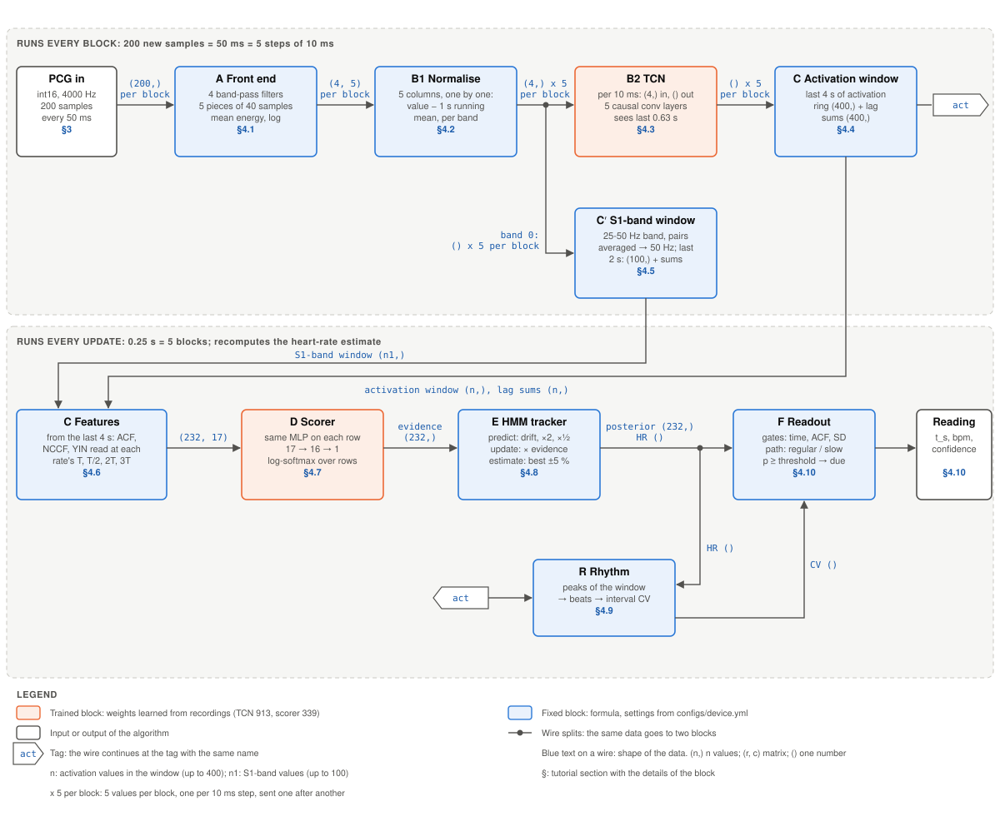

**At a glance** (units and windows: [§3](#3-time-units-and-windows)):
- **Input:** one block of 200 samples (50 ms) per call, 20 blocks per second.
- **Every step, 10 ms (5 per block):** one front-end column `(8,)` (6 band energies, voicing,
  impulsiveness) → one activation value; each activation value looks back 0.63 s.
- **Feature windows:** the last 4 s of activation (400 values) and the last 2 s of the
  25-50 Hz band (100 values).
- **Every update, 0.25 s (every 5th block):** feature matrix of 232 candidate rates x 17 features →
  scores → HMM → updated heart-rate estimate (4 estimates per second).
- **Readings:** the first when a heart has been heard for 1 s and the estimate is confident,
  at 1.5 s at the earliest (3 s median for regular hearts, from 3 s for slow or irregular ones);
  then one per second while a heartbeat is heard; 2 s without one restart the measurement.
  Before the first reading, 2 s without beat activity restart the analysis, so a placement with
  the input already running starts like a fresh measurement.

Each block in one line; the name links to its section.

| Block | What it does | In → out |
|---|---|---|
| [A Front end](#41-a-front-end) | splits the sound into 6 frequency bands, measures their loudness every 10 ms, and how voiced and how impulsive the sound is | `(200,)` → `(8, 5)` |
| [B1 Normalise](#42-b1-normalise) | subtracts each heart band's average over the last second | 5 x `(8,)` → 5 x `(8,)` |
| [B2 TCN](#43-b2-tcn) | small trained network: turns the 8 values into one beat signal (activation), 0 for other sounds | 5 x `(8,)` → 5 x `()` |
| [C Activation window](#44-c-activation-window) | keeps the last 4 s of activation and running sums of its self-similarity | `()` → `(400,)` + `(400,)` |
| [C′ S1-band window](#45-c-s1-band-window) | the same for the 25-50 Hz band (where S1 is), last 2 s | `()` → `(100,)` + `(100,)` |
| [C Features](#46-c-features) | measures how well the signals repeat at each of 232 candidate rates | windows → `(232, 17)` |
| [D Scorer](#47-d-scorer) | small trained network: one score per candidate rate | `(232, 17)` → `(232,)` |
| [E HMM tracker](#48-e-hmm-tracker) | combines the scores over time into a belief per rate, and an estimate | `(232,)` → `(232,)`, HR `()` |
| [R Rhythm](#49-r-rhythm) | picks the beats and measures how regular they are | `(n,)` → CV `()` |
| [F Readout](#410-f-readout-and-output) | decides whether a heart is heard and when to show the first reading, then shows one per second | → reading or nothing |

### The algorithm in 13 steps
Input: a block of 200 samples (50 ms at 4000 Hz) per call. Values in brackets: settings in
[`configs/device.yml`](../configs/device.yml).

**Every block (50 ms)**
1. **Split the sound into 6 bands** ([A](#41-a-front-end)): band-pass filters at 25-50, 50-100,
   100-200 and 200-400 Hz (the heart bands), 400-800 and 800-1600 Hz.
2. **Measure each step, 10 ms** ([A](#41-a-front-end)): log of the mean energy of each heart
   band; the two upper bands relative to the heart bands; voicing (pitch, as in speech) and
   impulsiveness (sharp clicks). 8 values per step, 5 steps per block.
3. **Remove each heart band's slow level** ([B1](#42-b1-normalise)): subtract a running mean
   (time constant 1 s, `net.norm_tau_s`). Contact pressure and gain drop out; only changes
   remain.
4. **Mark where beats sound** ([B2](#43-b2-tcn)): a small causal network (TCN) reads the 8
   values of each step, looking back 0.63 s, and outputs one activation value in [0, 1], high
   while a heart sound is playing and near 0 for speech, knocks, taps and other sounds.
5. **Keep a history** ([C](#44-c-activation-window), [C′](#45-c-s1-band-window)): the last 4 s of
   activation (`features.window_s`) and the last 2 s of the 25-50 Hz band, where S1 is loudest
   (`features.s1_window_s`).

**Every update (0.25 s = 5 blocks)**

6. **Test each candidate rate for repetition** ([C](#46-c-features)): for 232 candidate rates,
   30 to 299 BPM, 1 % apart, how similar the history is to itself shifted by one beat period;
   also at half, double and triple the period, against half- and double-rate errors. 17
   features per candidate.
7. **Score the candidates** ([D](#47-d-scorer)): a small network turns each candidate's 17
   features into one score; as probabilities, their maximum is the snapshot HR.
8. **Track over time** ([E](#48-e-hmm-tracker)): the HMM combines the new scores with its
   previous belief. The heart rate is assumed to drift slowly (about 4 % per update) and rarely
   to jump to double or half. Estimate: probability-weighted mean around the peak.
9. **Check the rhythm** ([R](#49-r-rhythm)): beats picked from the activation; beat-interval
   CV ≥ 10 % (`decision.regular_max_cv`) means irregular.

**Readout: when a number is shown** ([F](#410-f-readout-and-output))

10. **Gates:** nothing before 1.5 s (`decision.min_s`), nor while the activation is not periodic
    enough (`decision.min_periodicity` 0.2) or flat (`decision.min_activation_sd` 0.03:
    silence, hum), nor until a learned presence gate has said "heart" (probability ≥ 0.6,
    `decision.presence_min`) for 1 s in a row (`decision.confirm_s`).
11. **First reading:**
    - regular heart: once the probability of being within ±3 BPM reaches 70 %
      (`readout.confidence`) and the snapshot HR agrees with the estimate within 5 %;
    - slow (< 50 BPM) or irregular heart: from 3 s (`readout.slow_irregular_after_s`), once the
      probability of being within ±10 BPM reaches 97 % (90 % from 4 s);
    - at 8 s (`readout.latest_s`): if the tracker holds at least 30 % of its probability within
      ±10 BPM of the estimate.
12. **Then one reading per second** (`stream.output_period_s`). An update without heartbeat
    (presence below 0.3, periodicity below 0.15, a flat activation or no recent repetition)
    gives no new reading; the last reading stays on show.
13. **Restart:** 2 s without heartbeat in a row (`decision.lost_after_s`; stethoscope lifted,
    contact lost) end the measurement. Readings stop, and a new first reading follows steps
    10-11. Before a first reading, 2 s with the activation below 0.4 (`decision.idle_s`,
    `idle_activation`: no heartbeat) restart the analysis every update until beats appear.

## 2. Terms
| Term | Meaning |
|---|---|
| PCG | phonocardiogram: heart-sound audio, 4000 samples per second |
| S1, S2 | first and second heart sound of each beat; S2 follows S1 by about 0.3 s at 72 BPM |
| sample, step, block, update | the four time units: 0.25 ms, 10 ms, 50 ms, 0.25 s ([§3](#3-time-units-and-windows)); the code says "frame" for both the step (`net.py`) and the update (`estimator.py`), so this document avoids the word |
| snapshot HR | the best rate of one update on its own, before the HMM (code: `frame_hr`) |
| activation | output of the TCN: one value in [0, 1] per step, high while a beat sounds |
| lag, period T | a time shift in steps; a rate's period T = 6000 / BPM steps (72 BPM: 83.3) |
| ACF | autocorrelation: how similar a signal is to itself shifted by a lag (1 = identical) |
| NCCF, YIN | two variants of the ACF from speech pitch tracking, more robust at long lags |
| candidate rate | one of 232 heart rates, 30 to 299 BPM, 1 % apart; row i = 30 x 1.01^i BPM |
| TCN | temporal convolutional network: stacked causal 1-D convolutions (past input only) |
| MLP | multilayer perceptron: a small fully connected network |
| HMM, posterior | hidden Markov model; its probability for each of the 232 rates |
| CV | coefficient of variation of beat intervals: SD / mean (0 = perfectly regular) |
| shapes | `(n,)` vector of n values, `(r, c)` matrix, `()` one number; 5 x `(8,)`: five vectors one after another |

## 3. Time units and windows
The document uses four time units, each a whole multiple of the one before:
```
1 sample = 0.25 ms                        one PCG value (4000 per second)
1 step   = 40 samples = 10 ms             8 front-end values; one TCN output (activation)
1 block  = 5 steps    = 50 ms             200 samples: what the algorithm receives per call
1 update = 5 blocks   = 0.25 s            the heart-rate estimate is recomputed (4 per second)
```
A runs once per block and produces 5 steps; B and the windows then run once per step; C
Features to F run once per update.

Windows are not units: they say how much of the past a block looks at.
```
TCN                0.63 s   = 63 steps    each activation value depends on this much sound
S1-band window     2 s      = 100 values  one value per 2 steps (§4.5)
activation window  4 s      = 400 steps   each estimate is computed from this (§4.4)
HMM                all earlier updates    their evidence fades but still counts (§4.8)
```
Nested, at one moment ("now" on the right; not to scale):
```
                                                                                    now
   │◀────────────────────── activation window: 4 s = 400 steps ──────────────────────▶│
                                             │◀──────── S1-band window: 2 s ─────────▶│
                                                             │◀ TCN look-back 0.63 s ▶│
                                                                  │◀─ update 0.25 s ─▶│
                                                                              │ block │ 50 ms
                                                                                 │step│ 10 ms
```
So every 0.25 s the estimate is recomputed from the last 4 s of activation (each value
summarising the last 0.63 s of sound) and combined by the HMM with all earlier updates. The
windows fill during the first 4 s; features start at 1 s (100 steps).

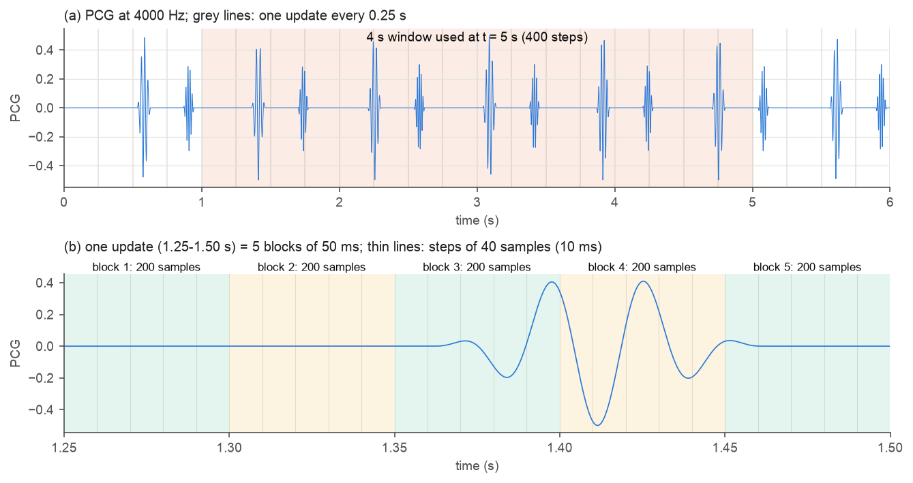

*(a) Six seconds of PCG; a grey line marks each update (0.25 s); the shaded part is the 4 s
window used at t = 5 s. (b) One update zoomed in: 5 blocks of 200 samples, each cut into 5 steps
of 40 samples.*

## 4. Blocks

### 4.1 A Front end
**Input:** one block of PCG, `(200,)`, 50 ms. **Output:** `(8, 5)`: 8 values x 5 steps of
10 ms. **Runs:** every block. **Code:** [frontend.py](../src/device/frontend.py),
[frontend.c](../c/src/frontend.c).

- Four heart bands: 25-50, 50-100, 100-200, 200-400 Hz, as log energies. S1 is strongest in the
  lowest band, S2 higher; noise that fills one band leaves the others usable.
- Two upper bands, 400-800 and 800-1600 Hz, as ln(E band / E heart bands): speech, knocks and
  friction put energy there, heart sounds hardly any. Level-free, so not normalised (§4.2).
- Voicing: the highest local peak of the normalised cross-correlation of the 100-1600 Hz signal
  over lags of 2.5-12 ms (pitch 83-400 Hz), within the current block. Near 1 for voiced speech,
  below 0.25 for heart sounds.
- Impulsiveness: ln(highest 1 ms energy / mean energy) of the same signal. High for knocks and
  taps (shorter than 20 ms), low for heart sounds (about 100 ms).
- The filters keep their state between blocks, so the 200 samples continue the previous block
  without a gap.

**Shape walk: 200 samples in, 8 x 5 out** (the 4 heart bands; the other 4 rows follow the same
10 ms grid).
```
one block: 200 samples (50 ms)                                         shape
pcm ────────────────────────────────────────────────────────────▶ (200,)
4 band-pass filters, each filters all 200 samples ──────────────▶ (4, 200)    4 filtered copies
cut each copy into 5 pieces of 40 samples (10 ms) ──────────────▶ (4, 5, 40)
square each sample, average the 40 ─────────────────────────────▶ (4, 5)      mean energy
natural log ────────────────────────────────────────────────────▶ (4, 5)      4 bands x 5 steps
```
```
              │── 10 ms ──│── 10 ms ──│── 10 ms ──│── 10 ms ──│── 10 ms ──│
samples         1 ... 40   41 ... 80   81 ... 120  121 ... 160 161 ... 200
25-50 Hz        e[0,0]     e[0,1]      e[0,2]      e[0,3]      e[0,4]
50-100 Hz       e[1,0]     e[1,1]      e[1,2]      e[1,3]      e[1,4]
100-200 Hz      e[2,0]     e[2,1]      e[2,2]      e[2,3]      e[2,4]
200-400 Hz      e[3,0]     e[3,1]      e[3,2]      e[3,3]      e[3,4]
```
Rows are bands, columns are 10 ms steps. Example (heart bands): the block at 1.35-1.40 s, where
an S1 starts at about 1.36 s:

| Band | 1.35-1.36 s | 1.36-1.37 s | 1.37-1.38 s | 1.38-1.39 s | 1.39-1.40 s |
|---|---|---|---|---|---|
| 25-50 Hz | −27.6 | −14.4 | −10.6 | −6.7 | −4.5 |
| 50-100 Hz | −27.6 | −13.2 | −8.9 | −7.1 | −6.3 |
| 100-200 Hz | −27.6 | −14.4 | −11.6 | −9.9 | −9.4 |
| 200-400 Hz | −27.6 | −17.5 | −14.6 | −12.8 | −12.1 |

−27.6 = ln(1e-12), the floor: silence before S1. The S1 then rises in every band, most in
25-50 Hz.

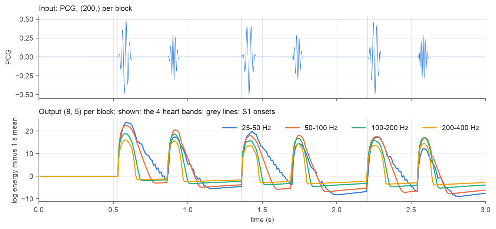

*Heart bands after normalisation (§4.2): each heart sound becomes a bump in all four bands; S1
(first bump of each pair) is strongest in 25-50 Hz (blue).*

### 4.2 B1 Normalise
**Input:** one column of A's output: 8 numbers for one 10 ms step. **Output:** 8 numbers: the 4
heart-band log energies minus each band's average over about the last second; the other 4
values (upper-band ratios, voicing, impulsiveness) unchanged, as they carry no level.
**Runs:** every step: 5 times per block, once per column, in time order. **Code:** `normalise` in
[net.py](../src/device/net.py), `hr_net_normalise` in [net.c](../c/src/net.c).

**From (8, 5) to (8,).** Nothing is reduced: the 5 columns of A's output are sent one after
another, each through B1 and then the TCN, before the next column.
```
A's output (8, 5):  column 0   column 1   column 2   column 3   column 4
                    0-10 ms    10-20 ms   20-30 ms   30-40 ms   40-50 ms
                       │          │          │          │          │
B1 Normalise:        (8,)       (8,)       (8,)       (8,)       (8,)      same shape out
B2 TCN:               ()         ()         ()         ()         ()       5 activations per block
```

**How, for one heart band** (the 4 heart bands are independent):
```
m = first value seen                        running average, one number per band
every 10 ms, new value x:
    m = m + 0.01 x (x − m)                  move the average 1 % of the way towards x
    output = x − m                          how far x is above (+) or below (−) the average
```
The average moves only 1 % per step, so it follows slow changes (about 100 steps = 1 s) such
as gain and contact pressure, but not a heart sound of about 0.1 s. Heart sounds come out as
large positive values, the background near 0. In the log domain a gain change is an added
constant, so subtracting the average removes it.

Example, 25-50 Hz band at 1.36-1.37 s: x = −14.4 (S1 starting), m = −23.0, output = +8.6: the
S1 is 8.6 log units above the last second's average.

Besides the TCN, band 0 of the output (25-50 Hz) also goes to the S1-band window (§4.5).

### 4.3 B2 TCN
**Input:** one normalised column `(8,)` every 10 ms. **Output:** one number, the activation, in
[0, 1], every step (5 per block). **Code:** `step` in [net.py](../src/device/net.py),
`hr_net_step` in [net.c](../c/src/net.c).

**What the output means.** The activation is a beat signal: close to 1 while a beat sounds (S1
through systole), close to 0 between beats and for sounds that are not heart sounds. It is
neither a heart rate nor a beat time; the rate comes later, from how often the activation
repeats (§4.6).

**How long it looks.** The TCN has no fixed input length. It runs continuously, one 10 ms
step at a time, and keeps its own memory of past inputs. Each output depends on the last 63
steps = 0.63 s of input, about one S1-S2 pair. It is causal: only present and past input, so it
adds no delay.

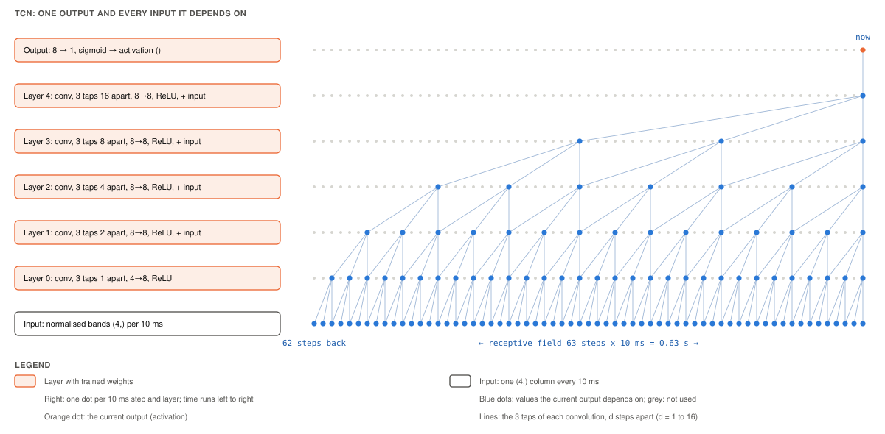

*Left: the layers, input at the bottom. Right: the inputs one output depends on. Each layer
combines 3 values of the layer below: now, d steps back and 2d steps back, with d doubling per
layer (1, 2, 4, 8, 16). Five layers reach 1 + 2 x (1 + 2 + 4 + 8 + 16) = 63 steps = 0.63 s back
with only 1,009 weights.*

| Layer | Combines (steps back) | In | Weights | Out |
|---|---|---|---|---|
| 0 | 0, 1, 2 | `(8,)` | `(8, 8, 3)` + 8 bias | `(8,)`, ReLU |
| 1 | 0, 2, 4 | `(8,)` | `(8, 8, 3)` + 8 | `(8,)`, ReLU, + input |
| 2 | 0, 4, 8 | `(8,)` | `(8, 8, 3)` + 8 | `(8,)`, ReLU, + input |
| 3 | 0, 8, 16 | `(8,)` | `(8, 8, 3)` + 8 | `(8,)`, ReLU, + input |
| 4 | 0, 16, 32 | `(8,)` | `(8, 8, 3)` + 8 | `(8,)`, ReLU, + input |
| output | 0 | `(8,)` | `(8,)` + 1 | `()`, sigmoid → [0, 1] |

"+ input" (residual): the layer adds its input to its output, so each layer learns a correction.
Weights: 5 x 200 + 9 = 1,009.

**Shapes of the TCN, by how it is run:**
```
on the device, per step:   (8,) ──▶ (8,) ──▶ (8,) ──▶ (8,) ──▶ (8,) ──▶ (8,) ──▶ ()
                           input    layer 0  layer 1  layer 2  layer 3  layer 4  output
   memory kept per layer:  past inputs (8, 2), (8, 4), (8, 8), (8, 16), (8, 32): 496 values
per block:                 (8, 5) ──▶ (5,)          5 steps, one after another
whole recording, offline:  (8, T) ──▶ (T,)          T = 100 steps per second
training:                  (32, 8, 400) ──▶ (32, 400)   batches of 32 clips of 4 s; the loss
                                                         uses the last 2-4 s of each clip
```
Being causal and convolutional, the same weights run on a stream of any length. Training uses
no beat labels: the output must repeat at the period of the heart rate measured on the ECG, stay
close to the previous network's (hr_v8) output on the recording without added noise, and stay
at 0 on clips of other sounds (speech, knocks, rubbing, music; [data.md](data.md) §4.1 and §5).

Example: the block at 1.35-1.40 s gives activation `[0.02, 0.43, 1.0, 0.92, 0.98]`: the beat
appears in its second 10 ms step.

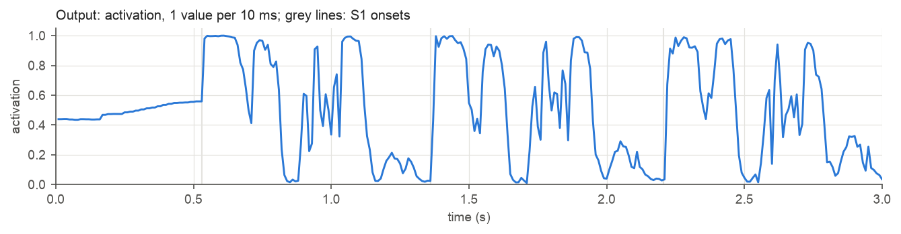

*The activation is high from S1 through systole and low in diastole: one wide pulse per beat.
The flat 0.5 before the first beat is start-up.*

### 4.4 C Activation window
**Input:** one activation value every 10 ms. **Output:** the window `(n,)` of the most recent
activation and its lag sums `(n,)`, n = min(100 x t, 400) at t seconds. **Runs:** every 10 ms.
**Code:** `push` in [features.py](../src/device/features.py), `hr_window_push` in
[features.c](../c/src/features.c).

The memory of block C: the last 4 s of activation, plus running sums that make the
periodicity curves of §4.6 cheap.

- **Ring buffer** `(400,)`: each new value is stored; once 400 are stored, it overwrites the
  oldest. The window always holds the most recent 4 s (shorter during the first 4 s).
- **Lag sums** `(400,)`: S[k] = sum of x(i) x x(i − k) over all pairs in the window that are k
  steps apart. S[k] is large when the signal matches itself shifted by k steps. §4.6 turns S
  into the ACF.
- **Running update**: a new value adds its products with the window; the value that drops out
  removes its products. Example with a 5-value window:

```
window [a b c d e]       S[1] = a·b + b·c + c·d + d·e
f arrives, a drops out   S[1] = S[1] − a·b + e·f       one subtraction, one addition per lag
window [b c d e f]
```
- Cost: at most 2 x 400 multiply-adds per value, 80,000 per second. Recomputing all 400 lags
  every update would take 400 x 401 / 2 = 80,200 per update, 320,000 per second.
- The same window feeds R (§4.9, picked beats) and the gates of F (§4.10, activation SD).

### 4.5 C′ S1-band window
**Input:** band 0 (25-50 Hz) of B1's output, one value every 10 ms. **Output:** the window
`(n1,)` and its lag sums `(n1,)`, n1 = min(50 x t, 100). **Runs:** every 20 ms. **Code:**
`feed` in [estimator.py](../src/device/estimator.py), [estimator.c](../c/src/estimator.c).

A second, independent periodicity signal, built from the 25-50 Hz band instead of the TCN.

- **What goes in**: the normalised 25-50 Hz log energy from B1 (before the TCN). Two
  consecutive 10 ms values are averaged into one, so the band is stored at 50 Hz.
- **What it keeps**: the last 2 s (100 values) and lag sums, updated as in §4.4. Lags here
  count 20 ms steps, so a rate's period is T/2 of these steps (72 BPM: 41.7).
- **Why**: S1 is low-pitched (mostly 25-50 Hz), S2 higher. In this band each beat shows mainly
  its S1, so the band repeats once per beat even when S2 is as loud as S1. If the activation
  ever pulses on S2 as well, it repeats at T/2 and the double rate looks right; the S1 band
  does not. Adding these features removed the double-rate readings with loud S2 in the
  synthetic corner cases ([results.md](results.md) §11).
- **Used for**: columns 14-16 of the feature matrix (§4.6), for rates up to 250 BPM; above
  that S1 and S2 merge and the band says nothing.
- **Why 2 s at 50 Hz**: 800 bytes of memory instead of 3,200 for a 4 s copy at 100 Hz.

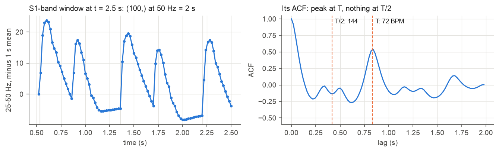

*Left: the S1-band window at 2.5 s. Each beat gives a tall S1 bump and a smaller S2 bump (the
synthetic S2 at 70 Hz leaks through the filter edge). Right: its ACF peaks at T (72 BPM) and is
negative at T/2, so the band votes against 144 BPM. In this example the activation agrees; the
band matters when it does not.*

### 4.6 C Features
**Input:** the activation window and lag sums `(n,)`, the S1-band window and lag sums `(n1,)`.
**Output:** the feature matrix `(232, 17)`: one row per candidate rate. **Runs:** every update
(0.25 s). **Code:** `compute` in [features.py](../src/device/features.py),
[features.c](../c/src/features.c).

Idea: if beats repeat every T, the activation shifted by T looks like itself. Test all 232
candidate rates at once.

1. **Lag curves**: from the lag sums, the ACF, NCCF and YIN over all lags, each `(n,)`, and
   the S1-band ACF `(n1,)`. The ACF and NCCF are kept in steps of 1/32767 (int16 on the
   device, the same rounding in the Python reference); the peak positions of columns 10-13 use
   the ACF before this rounding.
2. **Read at each rate**: for row i, read the curves at that rate's period T, and at T/2, 2T,
   3T → 17 numbers per row → `(232, 17)`.

**Shape walk: two windows in, a 232 x 17 matrix out.**
```
activation lag sums (n,) ── remove mean, normalise ─────────────▶ ACF, NCCF, YIN: (n,) each
                                                                  one value per lag 0 .. n-1
S1-band lag sums (n1,) ── remove mean, normalise ───────────────▶ S1 ACF (n1,)
for each rate i = 0..231: read the curves at T_i, T_i/2, 2T_i, 3T_i ──▶ row (17,)
stack the 232 rows ─────────────────────────────────────────────▶ (232, 17)
```
The lag axis becomes the rate axis here: a curve over lags `(n,)` is read at 232 lags, one per
candidate rate, giving a column `(232,)`. Example, row 88 (72.0 BPM) at 2.5 s: T = 6000 / 72.0 =
83.32 steps, between lags 83 and 84, so ACF(83.32) = ACF[83] + 0.32 x (ACF[84] − ACF[83]) =
0.541 + 0.32 x (0.514 − 0.541) = 0.533: row 88, column 1.

| Columns | What they say |
|---|---|
| 1-3: ACF, NCCF, YIN at T | how well the signal repeats at this rate |
| 4-9: ACF at T/2, 2T, 3T; NCCF at 2T; 2 flags | half/double check: the true rate repeats at 2T, not at T/2 |
| 10-13: is it a peak, distance to the best, offset to nearest peak, periods in window | context |
| 14-17: S1-band ACF at T, T/2, 2T; flag (rates ≤ 250 BPM) | the same check on the S1 band (§4.5) |

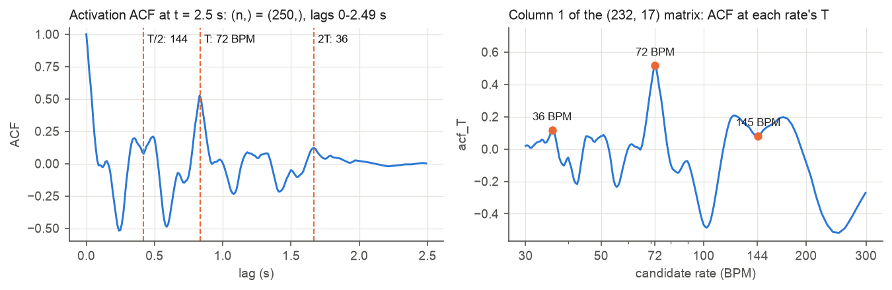

*Left: the ACF peaks at 0.83 s, the period of 72 BPM. Right: column 1 of the matrix, the ACF
read at each candidate rate's period, is highest at 72 BPM.*

Example rows at 2.5 s:

| Row | Rate | ACF at T | ACF at T/2 | ACF at 2T | NCCF at T | S1 ACF at T |
|---|---|---|---|---|---|---|
| 18 | 35.9 BPM (half) | 0.15 | 0.52 | 0 (2T outside window) | 0.59 | 0.14 |
| 88 | 72.0 BPM (true) | **0.53** | −0.05 | 0.15 | **0.77** | **0.53** |
| 158 | 144.5 BPM (double) | −0.05 | −0.30 | 0.54 | −0.06 | −0.13 |

The half rate gives itself away by a high ACF at T/2 (a faster rate fits too); the double rate
by a low ACF at its own T.

### 4.7 D Scorer
**Input:** the feature matrix `(232, 17)`. **Output:** log-likelihood `(232,)`, one per
candidate rate, and the snapshot HR (the best rate of this update alone). **Runs:** every update.
**Code:** [scorer.py](../src/device/scorer.py), [scorer.c](../c/src/scorer.c).

- The same small MLP scores every row: 17 inputs → 16 hidden units (ReLU) → 1 score. 339
  trained parameters.
- The rate itself is never an input: the scorer judges "does this row look like a true
  period", not "is 72 BPM common".
- Log-softmax over the 232 scores gives a probability per rate for this update alone. Its peak
  is the snapshot HR. Multiplied by 0.35 it becomes the HMM's evidence: neighbouring updates share
  3.75 of their 4 s, so each counts about a third.

**Shape walk: 232 rows of 17 in, one score per row out.**
```
(232, 17) ── standardise each column (mean, SD from training) ──▶ (232, 17)
          ── x W1 (17, 16) + b1 (16,), ReLU ────────────────────▶ (232, 16)
          ── x W2 (16,) + b2 () ────────────────────────────────▶ (232,)   one score per rate
          ── log-softmax over the 232 ──────────────────────────▶ (232,)   log-probabilities
          ── argmax ────────────────────────────────────────────▶ ()       snapshot HR (BPM)
          ── x 0.35 ────────────────────────────────────────────▶ (232,)   evidence for E
```
Rows do not see each other until the softmax, which compares them.

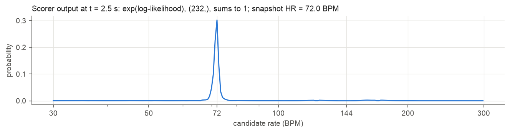

*One update on its own already points at 72 BPM (peak 0.21 of the total probability).*

### 4.8 E HMM tracker
**Input:** evidence `(232,)` from D and the posterior `(232,)` of the previous update.
**Output:** the new posterior `(232,)` and the heart-rate estimate (one number, BPM).
**Runs:** every update. **Code:** [tracker.py](../src/device/tracker.py),
[tracker.c](../c/src/tracker.c).

One update can be fooled; the HMM keeps a belief over the 232 rates and updates it every 0.25 s:

1. **Predict:** let the belief spread, because the rate can change:
   - drift: blur by about ±4 % (a 27-tap Gaussian over the rates);
   - octave jump: move 0.2 % of the belief to exactly double or half (70 rows away), so a
     wrong half/double lock can be corrected, but only by sustained evidence;
   - floor: spread 0.05 % evenly, so recovery is always possible.
2. **Update:** multiply by exp(evidence) and normalise; rates the sound supports grow.
3. **Estimate:** at the most likely row, the probability-weighted mean of ±5 rows (±5 %).

It starts uniform; before features exist (first 1 s) it only spreads.

**Shape walk: everything stays (232,) until the last step.**
```
posterior from the last update ─────────────────────────────────▶ (232,)
  ── blur with a 27-tap Gaussian ───────────────────────────────▶ drift (232,)
  ── shift by +70 and −70 rows (x2, x½) ────────────────────────▶ octave (232,)
  ── 0.9975 x drift + 0.002 x octave + 0.0005 / 232 ────────────▶ prior (232,)
  ── x exp(evidence (232,)), divide by the sum ─────────────────▶ posterior (232,), sums to 1
  ── most likely row ± 5 rows ──────────────────────────────────▶ (11,)
  ── probability-weighted mean of their rates ──────────────────▶ HR ()
```

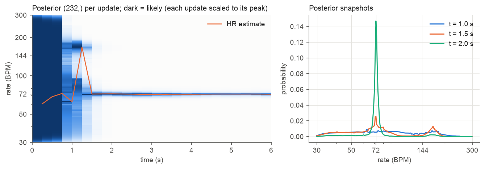

*Left: dark = likely. The belief is uniform until 1 s, wide at 1-1.5 s, and locked on 72 BPM
from 2 s. Right: peak probability 0.008 at 1.0 s, 0.024 at 1.5 s, 0.128 at 2.0 s.*

### 4.9 R Rhythm
**Input:** the activation window `(n,)` and the HR estimate. **Output:** the beat-interval CV
(one number). **Runs:** every update. **Code:** [rhythm.py](../src/device/rhythm.py),
[rhythm.c](../c/src/rhythm.c).

- Pick beats in the 4 s activation window: peaks above 0.4 x the window maximum, taken from the
  highest, at least 0.6 x the estimated period apart (this skips S2).
- CV of the beat intervals tells regular (low) from irregular (high, e.g. atrial fibrillation).

**Shape walk: a 4 s curve in, one number out.**
```
activation window ──────────────────────────────────────────────▶ (n,)    n = 400 from 4 s
  ── local peaks ≥ 0.4 x window maximum ────────────────────────▶ (m,)    peak positions
  ── keep highest first, ≥ 0.6 x period apart ──────────────────▶ (b,)    beats
  ── differences of neighbours ─────────────────────────────────▶ (b−1,)  intervals
  ── SD / mean ─────────────────────────────────────────────────▶ CV ()
```
Example at 4 s: n = 400, b = 5 beats, 4 intervals, CV 0.018.

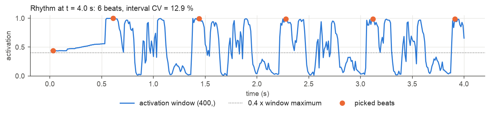

*At 4 s: 5 beats, interval CV 1.8 %, a regular rhythm.*

### 4.10 F Readout and output
**Input:** posterior `(232,)`, HR estimate, snapshot HR, CV, periodicity (activation ACF at the
estimate's period) and activation SD. **Output:** a reading (time, BPM, confidence) or nothing.
**Runs:** every update. **Code:** [readout.py](../src/device/readout.py),
[readout.c](../c/src/readout.c).

Before the first reading, each update:

1. **Heart present?** All of: time ≥ 1.5 s; periodicity ≥ 0.2; activation SD over the window
   ≥ 0.03; the presence gate (a small MLP over periodicity, recent repetition, activation SD,
   agreement, posterior masses and the upper-band level) ≥ 0.6, for the last 1 s. Otherwise
   nothing (silence, mains hum, other sounds).
2. **Path:** slow or irregular if HR < 50 BPM or CV ≥ 10 %; regular otherwise.
3. **Confidence:** a logistic model of the posterior mass near the estimate and the
   periodicity gives `p_fine` = probability of being within ±3 BPM (regular path) or `p_rough`
   = within ±10 BPM (slow or irregular path).
4. **Due?**
   - regular: snapshot HR within 5 % of the HMM estimate and `p_fine` ≥ `confidence` (0.7);
   - slow or irregular: from 3 s, when `p_rough` ≥ 0.97; from 4 s, when `p_rough` ≥ 0.9;
   - any heart: at 8 s, if the mass within ±10 BPM ≥ 0.3.

**Shape walk: arrays reduced to a few numbers, then to one decision.**
```
posterior (232,) ── sum of rows within ±4 BPM of HR ────────────▶ fine mass ()
                 ── sum of rows within ±10 BPM of HR ───────────▶ rough mass ()
fine mass (), periodicity () ── logistic, 3 coefficients ───────▶ p_fine ()
rough mass (), periodicity () ── logistic, 3 coefficients ──────▶ p_rough ()
gates, path, p_fine or p_rough, time ── rules 1-4 ──────────────▶ due: yes / no
yes ────────────────────────────────────────────────────────────▶ reading (t_s, bpm, confidence)
```
Example: at 2.0 s `p_fine` is already 0.85, but the picked beats' CV puts the heart on the
slow/irregular path and the presence gate is at 0.33. Presence reaches 0.68 at 2.5 s; after 1 s
of presence, at 3.25 s, `p_rough` 0.98 ≥ 0.97 → reading (3.25 s, 71.5 BPM, 0.98).

After the first reading: the current HMM estimate every 1 s while a heartbeat is heard. An
update without heartbeat (presence < 0.3, periodicity < 0.15, activation SD < 0.03 or recent
repetition < 0.2) gives no new reading; 2 s of them in a row restart the measurement
(`readout.lost`, `hr_lost`): readings stop until the next first reading. Firmware that detects
contact loss itself can call `hr_reset` to end the readings at once.

Before the first reading: after 2 s with the activation below 0.4, the analysis (windows,
tracker, readout, clock) restarts every update until the activation rises; front end and
network keep running (`restart_analysis`). With the input running before the stethoscope is
placed, the analysis therefore starts at the placement, as in a fresh measurement.

**Output.** Python `process()` returns `(t_s, bpm, confidence)` or `None`. C
`hr_process_block()` returns 1 and fills `hr_reading_t` {`t_s`, `bpm`, `confidence`, `path`,
`first`}, else 0. `hr_get_frame_info()` gives the estimate, gates and probabilities of the latest
update at any time. The three `readout` settings can change at runtime without retraining.

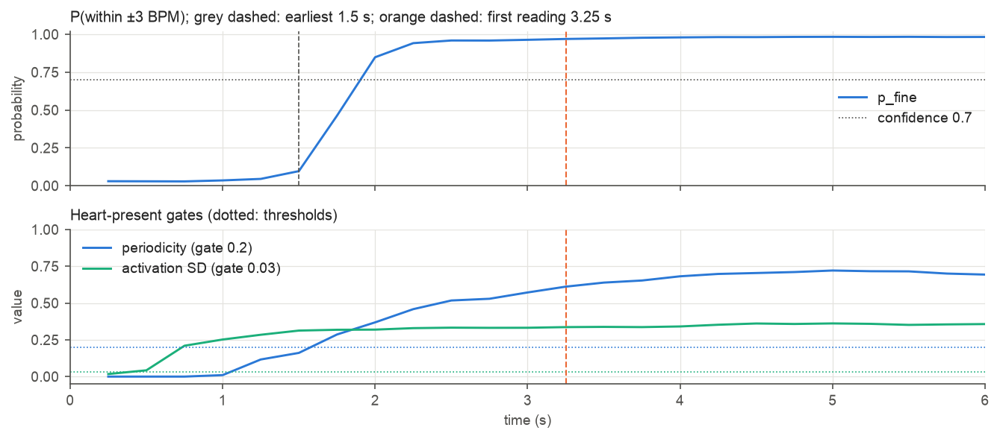

*`p_fine` crosses 0.7 at 2.0 s, but the presence gate holds the reading until 3.25 s (1 s
after it opens at 2.5 s), when the slow/irregular rule (`p_rough` ≥ 0.97 from 3 s) is met.*

## 5. One heart end to end

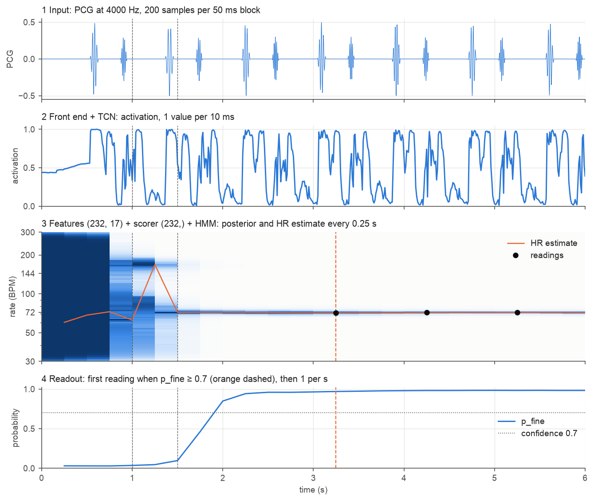

*Synthetic regular 72 BPM heart, 6 s. Grey dashed lines: features start (1.0 s) and earliest
allowed reading (1.5 s). Orange dashed: first reading.*

| Time | Window n | Inside the algorithm | Output |
|---|---|---|---|
| 0-1 s | 0 → 100 | A and B run every step; windows fill; HMM belief uniform | nothing |
| 1.0 s | 100 | first matrix `(232, 17)`; HMM's first evidence; estimate 62.7 BPM, `p_fine` 0.04 | nothing |
| 1.5 s | 150 | earliest allowed time; estimate 71.9 BPM, but the picked beats' CV puts it on the slow/irregular path; presence 0.08 | nothing |
| 2.0 s | 200 | estimate 72.2 BPM, periodicity 0.37, `p_fine` 0.85; presence 0.33 < 0.6 | nothing |
| 2.5 s | 250 | presence 0.68 ≥ 0.6: heart present, 1 s confirmation starts | nothing |
| 3.25 s | 325 | presence held 1 s; `p_rough` 0.98 ≥ 0.97 (slow/irregular path, from 3 s) | **first reading: 71.5 BPM, confidence 0.98** |
| 4.25, 5.25 s | 400 from 4 s | HMM refines | 71.8, 71.9 BPM, confidence 0.98 |

On real recordings the first reading for regular hearts comes at 3 s (median, test split);
slow or irregular hearts from 3 s ([results.md](results.md) §2).
